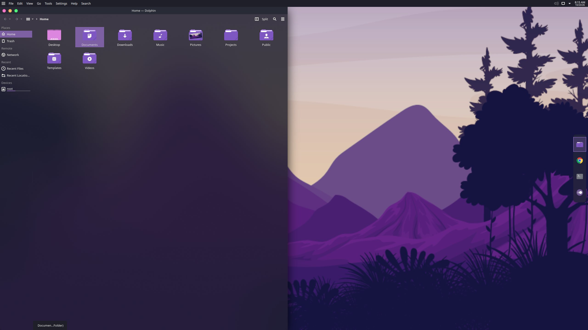
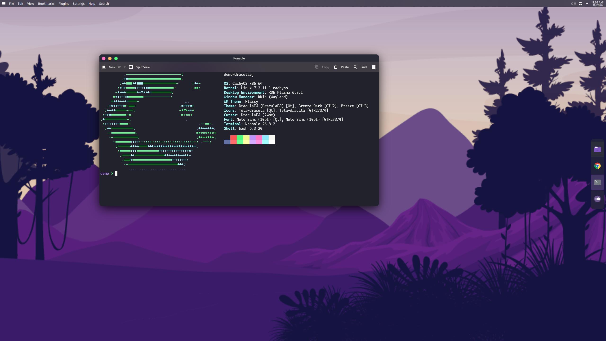

# DraculaEJ

A dark KDE Plasma 6 theme built on the free
[Dracula KDE theme](https://github.com/dracula/gtk/tree/master/kde) (GPL-3.0),
made to feel more like macOS: stoplight window buttons on the left, purple
folders, and a matching Konsole.

**This is an unofficial remix.** It is not made or endorsed by Dracula Theme.
Modified by Eric on 2026-10-23 from `dracula/gtk` commit `71640b9`; the changes
are listed under "What it changes from stock Dracula" below.





<sub>Wallpaper: "Mountains" from [dracula/wallpaper](https://github.com/dracula/wallpaper)
(MIT). Screenshots come from a throwaway demo session; see
`tools/screenshot-demo/README.md`.</sub>

Every piece is named DraculaEJ (global theme `com.eric.DraculaEJ`), so it can be
installed next to the real Dracula KDE theme without clashing.

| Piece | Name |
| --- | --- |
| Global theme (look-and-feel) | `DraculaEJ` (`com.eric.DraculaEJ`) |
| Color scheme | `DraculaEJ` (from upstream's purple variant) |
| Plasma desktop theme | `DraculaEJ` |
| Window decoration | Klassy with the `DraculaEJ` preset; Aurorae `DraculaEJ` as a fallback |
| Kvantum theme | `DraculaEJ` (from upstream's `Dracula-purple`) |
| Application style | `kvantum` |
| Konsole | `DraculaEJ` profile with the official Dracula colors |
| Icons | `Tela-dracula` (installed separately, see below) |
| Cursors | `DraculaEJ-cursors` |

## What it changes from stock Dracula

| Piece | Stock Dracula | DraculaEJ |
| --- | --- | --- |
| Window decoration | Aurorae (SVG) | [Klassy](https://github.com/paulmcauley/klassy), which draws crisp buttons at 125% scale; the redrawn Aurorae buttons stay as a fallback |
| Window buttons | red / yellow / green, soft edges | 18 px circles: pink `#ff79c6` / orange `#ffb86c` / green `#50fa7b`, with x, -, + on hover and plain gray when the window is not focused |
| Button order | not set | close, minimize, maximize on the left (`XIA`), like macOS |
| Title bar | - | solid, no window borders |
| Color scheme | Dracula (gray highlights) | purple highlights (upstream's DraculaPurple) |
| Konsole | not themed | [dracula/konsole](https://github.com/dracula/konsole) colors (MIT) as the default profile |
| Icons | candy-icons | Tela-dracula, with folders recolored to `#7e57c2` |
| Launcher icon | - | white three-line menu icon, `draculaej-menu-launcher` |
| KDE Store downloads | 9 items listed | removed, so nothing is fetched |

Kept from stock, under the new names: the purple Kvantum style (slightly
see-through windows with blur), the desktop theme for panels, and the cursors.
The gray and "Solid" variants are left out.

## Install

Install Klassy first if you want the crisp buttons (`paru --sync klassy`), then:

```sh
./install.sh          # copy the files only
./install.sh --apply  # copy, then switch to it
./uninstall.sh        # remove the files (switch to another theme first)
```

`--apply` also writes the settings a global theme can't set by itself: the
Kvantum theme, the button order (in your own `kwinrc`), Konsole's default
profile, the Aurorae button size (in `auroraerc`), and, when Klassy is
installed, the Klassy preset and the switch to Klassy. Without Klassy it uses
the Aurorae buttons.

### Window buttons (Klassy)

Aurorae draws its buttons small and then stretches them, so at 125% scale they
look soft. Klassy draws them at the screen's real resolution. Loading the preset
also writes `BorderSize=None` (no window borders) to `kwinrc`. To change the
preset, edit `tools/make_klassy_preset.py` and rebuild it from Klassy's "Eaten
Fruits" preset:

```sh
python3 tools/make_klassy_preset.py klassy/Eaten_Fruits-6.7.3.klpw klassy/DraculaEJ.klpw
```

### Purple folders (Tela-dracula)

Tela isn't bundled. Get it at the tested commit, apply the color patch, and run
its installer:

```sh
git clone https://github.com/vinceliuice/Tela-icon-theme.git ~/.local/src/Tela-icon-theme
cd ~/.local/src/Tela-icon-theme
git checkout a1fffc5bfab716bd022dd228ee96fe3965cdb33d
patch --input=$HOME/Projects/DraculaEJ/tela/install-ej.patch install.sh
./install.sh dracula
```

The patch changes one line: the dracula folder color from `#44475a` to `#7e57c2`.

### Launcher icon

The icon file is installed by `install.sh`. Pointing the launcher at it is a
panel setting, not a theme setting:

```sh
qdbus6 org.kde.plasmashell /PlasmaShell org.kde.PlasmaShell.evaluateScript 'panels().forEach(function (p) { p.widgets("org.kde.plasma.kickoff").forEach(function (w) { w.currentConfigGroup = ["General"]; w.writeConfig("icon", "draculaej-menu-launcher"); w.reloadConfig(); }); });'
```

## Switching back

Apply any other global theme (Breeze Dark here), then remove the settings that
`install.sh --apply` wrote to your own config files. Those beat any global
theme, so a theme switch alone leaves them in place:

```sh
plasma-apply-lookandfeel --apply org.kde.breezedark.desktop
kwriteconfig6 --notify --file kwinrc --group org.kde.kdecoration2 --key ButtonsOnLeft --delete
kwriteconfig6 --notify --file kwinrc --group org.kde.kdecoration2 --key ButtonsOnRight --delete
kwriteconfig6 --file kwinrc --group org.kde.kdecoration2 --key library --delete
kwriteconfig6 --file kwinrc --group org.kde.kdecoration2 --key theme --delete
kwriteconfig6 --file kwinrc --group org.kde.kdecoration2 --key BorderSize --delete
kwriteconfig6 --file kwinrc --group org.kde.kdecoration2 --key BorderSizeAuto --delete
kwriteconfig6 --file konsolerc --group "Desktop Entry" --key DefaultProfile --delete
qdbus6 org.kde.KWin /KWin reconfigure
./uninstall.sh
```

If you pointed the launcher at `draculaej-menu-launcher`, set it back too (the
Plasma default is `start-here-kde`).

## License

GNU GPL v3, the same as upstream Dracula KDE. See [LICENSE](LICENSE) and
[AUTHORS](AUTHORS).
